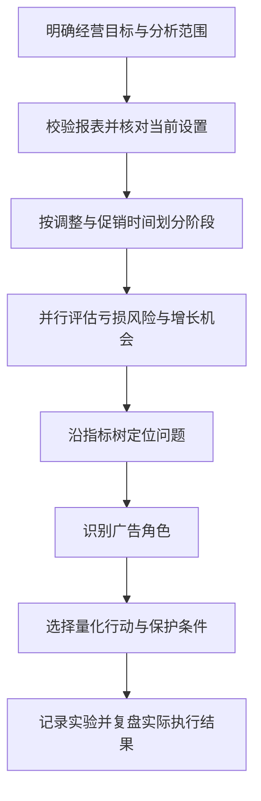

<div align="center">

# Ads Insights

> *亚马逊广告精细化诊断 — 假设驱动，保护有效曝光，让每次调整可验证、可回滚*

[](SKILL.md)
[](README.md)
[](agents/openai.yaml)
[](#安装)
[](references/hypothesis-register.md)

<br>

从广告报表到经营决策，先找到指标变化的真正环节<br>
8 步诊断流程 × 6 类行动 × 7 份参考指南<br>
把当前设置、流量质量、利润边界与验证计划放到同一张行动表里

[快速开始](#快速开始) · [工作流](#工作流) · [核心能力](#核心能力) · [输出示例](#输出示例) · [安装](#安装) · [方法论](#方法论)

</div>

---

## 一句话说清楚

> 给我广告报表和当前设置，帮你判断哪里该放量、哪里该止损、哪里值得做一次有边界的实验。

```text
用户 ❯ 帮我复盘这个 ASIN 最近两周的广告，保住有效流量，找出可执行的优化动作

Ads Insights ❯
  🎯 锁定范围：只分析指定 ASIN、SKU 或广告组合
  📊 重算指标：曝光 → 点击 → 转化 → 销售与利润
  🔍 排查原因：流量结构 / 价格促销 / 竞价层级 / 归因延迟
  ⚖️ 双向判断：急性亏损风险 + 被压制的增长机会
  🧪 选择行动：保持 / 放量 / 放量测试 / 收缩 / 隔离 / 停止或否定
  📋 交付计划：当前值、建议值、损失上限、曝光底线、验证与回滚
```

以上是交互形式示意，不代表真实账户分析结果。

---

## 工作流



| 步骤 | 关键问题 | 交付内容 |
|:---:|---|---|
| 01 | 要增长还是利润？分析哪些产品？ | 目标、范围白名单、盈亏与风险边界 |
| 02 | 数据可靠吗？建议是否已经执行？ | 重算指标、实时设置与操作台账 |
| 03 | 哪次改变之后出现了变化？ | 基线、过渡、评估及促销阶段 |
| 04 | 是曝光、点击还是转化出了问题？ | 指标树、备选解释与证据等级 |
| 05 | 这组流量承担什么任务？ | 收割、探索、防御、竞品、排名支持 |
| 06 | 今天具体应该怎么做？ | 六类行动与量化参数 |
| 07 | 怎么判断有效、什么时候撤回？ | 实验记录、曝光底线与精确回滚值 |
| 08 | 哪些已知，哪些还只是推测？ | 事实、推断、假设及缺失证据 |

---

## 核心能力

| 模块 | 解决的问题 |
|---|---|
| 范围锁定 | 同一报表含多个产品时，避免把无关广告带进诊断 |
| 当前状态核对 | 核对已执行的竞价、预算、展示位和否定，避免重复操作 |
| 流量质量诊断 | CPC 稳定但 CTR / CVR 下滑时，先检查流量与前台价格促销 |
| 双向决策 | 同时寻找止损点和放量机会，避免默认缩量或无条件观望 |
| 有效竞价拆解 | 区分基础竞价、竞价策略、展示位倍率与时段规则 |
| 细粒度控制 | 优先处理具体搜索词、ASIN 或目标，评估共享控制对健康单元的影响 |
| 有边界的放量测试 | 对高度相关或历史有转化的核心目标，设定机制、损失上限及回滚 |
| 归因与促销复盘 | 区分未成熟归因、完整交易日与前台优惠生效后的新评估阶段 |

## 快速开始

安装后，在支持本地 skill 的 AI 助手中调用：

```text
使用 $ads-insights 分析我上传的亚马逊广告报表。

站点：美国站
范围：仅分析我指定的 ASIN 和广告组合
目标：保护有效曝光，在风险可控的情况下寻找增长
目标 ACoS：[填写]；单日花费或测试损失上限：[填写]
最近调整：[填写时间、对象、调整前后值]

请先核对数据覆盖和当前设置，再给出逐广告行动表，
包含当前值、建议值、验证样本、曝光底线及精确回滚值。
```

建议提供：

- 最近 7–14 天广告表现与 14–30 天历史对照，低流量产品可延长窗口。
- 搜索词或客户 ASIN 明细、同日期展示位报告。
- 当前预算、基础竞价、竞价策略、展示位调整、目标和否定记录。
- 前台实际售价、优惠状态、库存及近期修改时间。
- 利润或可接受的目标 ACoS；未知时将经济性判断标记为暂定。

报表需求与可得结论详见 [数据要求](references/data-requirements.md)。分析工作簿时，需由运行环境提供电子表格读取与计算能力。

---

## 输出示例

以下为**虚构数据**，仅展示行动表结构，不是推荐竞价或通用阈值。

| 单元 | 判断 | 当前值 → 建议值 | 验证标准 | 保护与回滚 |
|---|---|---|---|---|
| 核心精准词 A | 放量测试 | 固定竞价 $1.00 → $1.15，其他控制不变 | 目标 CPC $0.95–$1.10；售价 $25、目标 ACoS 30% 时，所需 CVR 约 12.7%–14.7%；获得至少 20 次点击后评估 | 曝光目标较可比基线提升 20%；无订单花费达到 $15 或流量质量明显变差即恢复 $1.00 |
| 稳定收割词 B | 保持 | $0.85 → $0.85 | 经济性处于既定范围，按累计样本复核 | 低于既定有效曝光底线时重新诊断 |
| 探索目标 C | 隔离 | 先拆出已验证流量，再评估剩余池 | 看具体搜索词与 ASIN 的独立表现 | 保留已验证转化来源，避免共享竞价误伤 |

正式分析按以下顺序输出：

1. 3–5 条核心诊断。
2. 即时风险与机会决策，以及今天的具体行动。
3. 同口径周期证据表与重算指标。
4. 根因树、替代解释和置信度。
5. 逐广告或逐目标行动表，包含有依据的保持行。
6. 1 天健康检查、3 天方向检查、7–14 天转化检查，按样本量调整。
7. 会影响结论的缺失证据。
8. 后续需要验证的假设清单。

完整格式见 [输出模板](references/output-template.md)。

---

## 安装

本仓库是 Markdown 指令与参考资料组成的 skill，无独立服务、命令行分析程序或内置广告账户连接。数据读取及工具调用由运行它的 AI 助手提供。仓库本身没有 Python 或 Node 依赖。

### Codex

```bash
git clone https://github.com/CroTuyuzhe/ads-insights.git ~/.codex/skills/ads-insights
```

### Claude Code

```bash
git clone https://github.com/CroTuyuzhe/ads-insights.git ~/.claude/skills/ads-insights
```

### Windows PowerShell（Codex）

```powershell
git clone https://github.com/CroTuyuzhe/ads-insights.git "$env:USERPROFILE\.codex\skills\ads-insights"
```

也可下载仓库 ZIP，将包含 `SKILL.md` 的完整文件夹放入客户端的 skill 目录。安装后重新打开客户端或刷新 skill 列表。已有同名目录时，请先检查内容，避免覆盖自己的修改。

---

## 项目结构

```text
ads-insights/
├── README.md
├── SKILL.md                              # 触发条件、诊断流程与输出约定
├── agents/
│   └── openai.yaml                       # Codex 展示名称与默认提示
└── references/
    ├── data-requirements.md              # 数据要求与结论边界
    ├── diagnostic-model.md               # 指标树与干扰因素
    ├── bidding-strategy.md               # 竞价策略与展示位控制层
    ├── decision-rules.md                 # 行动选择与样本判断
    ├── advanced-operations-playbook.md    # 结构、放量与利润复盘
    ├── output-template.md                # 行动表与跟进格式
    └── hypothesis-register.md            # 待验证假设与空白证据模板
```

## 方法论

```text
Sales = Impressions × CTR × CVR × Average order value
Spend = Clicks × CPC
ACoS  = CPC / (CVR × Average order value)
```

- **先重算，再判断**：汇总分子分母后计算比例，避免平均 ACoS 或 CVR。
- **事实、推断、假设分开写**：短期相关性不直接等同因果。
- **止损和增长一起看**：先界定风险，再判断成熟放量或竞价门槛测试。
- **改动有记录、有边界**：明确验证样本、有效曝光底线、损失上限和回滚值。
- **数字阈值持续验证**：按产品、利润、流量角色与历史波动校准。

此 skill 仍处于持续验证阶段，不能保证 ACoS 或销售结果。公开版本保留方法论与假设，实际运营案例及经营数据不随仓库发布；证据区提供空白模板，供使用者在自己的环境积累记录。
